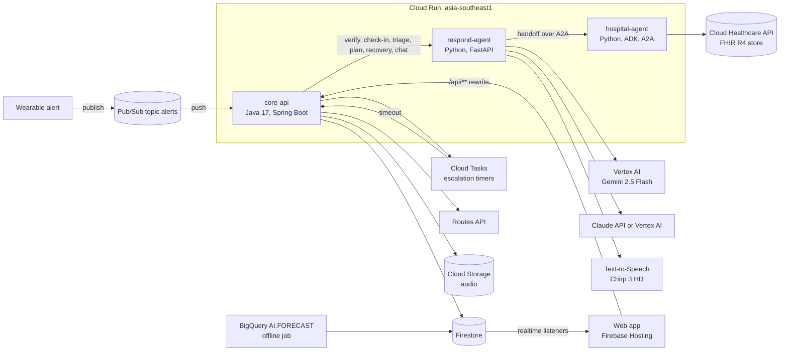

# No One Alone

> [!NOTE]
> **Future Health Digital Innovation Challenge (Department of Health Abu Dhabi):** start at [docs/submission/README.md](docs/submission/README.md). It has the live links, a 5-minute tour, architecture, responsible AI, data and assumptions, the evaluation and the path to pilot. This page covers the code: setup, run locally and deploy.

The emergency backend below was first built as an AI care agent for older people who live alone. When a wearable raises a critical alert, the agent checks whether it is real, talks to the person in their own language and form of address, decides how urgent it is, and gets the right family member to the door. For a suspected stroke it sends a pre-arrival packet to a stroke-ready hospital before the ambulance gets there. After discharge it turns the hospital's plan into plain reminders.

It began as an entry for the Google Cloud AI Builder Cup and is now the safety net inside the Abu Dhabi family-health journey. Live demo: https://noonealone.insidesync.ai

> [!IMPORTANT]
> **The live demo runs one emergency at a time and is shared by everyone who opens it. If the Emergency page says a demo incident is still running, or a run you started resets, someone else is trying it too. Wait a minute and reload the page.**

All people, places and medical records in this repo are fictional.

## Architecture



| Part | Folder | What it does |
|---|---|---|
| core-api | `core-api/` | Owns the incident. Takes alerts from Pub/Sub, runs the state machine (verify, check-in, triage, escalate, hand off, recover), sets escalation timers in Cloud Tasks, gets travel times from the Routes API and writes every state change to Firestore. Serves the web's `/api` routes. |
| respond-agent | `agents/respond/` | The care agent's judgement. Rules decide verification, triage and the escalation plan. Gemini judges the person's spoken check-in answers (for example slurred speech), writes the recovery summary and answers questions in the Ask Noa chat panel. Chirp 3 HD speaks every line in the person's language. It also writes the family-health panel's agent messages and reads typed replies with Claude, when the live switch is on. |
| hospital-agent | `agents/hospital/` | An ADK agent served over A2A. It reads the person's FHIR R4 record, applies their sharing consent and builds the pre-arrival packet for the receiving emergency department. The packet is built by rules, with no LLM, so it only ever contains what the record says. |
| Web app | `web/` | Vite, React and TypeScript. Views for the individual and their family health journey, the hospital and the government. It reads Firestore in real time, so the family and hospital screens move as the incident moves. |
| Forecast job | `data/predict/` | An offline job that screens family history and runs BigQuery `AI.FORECAST` (TimesFM) on synthetic blood pressure readings, then writes the result to Firestore for the "What's ahead" view. |
| Infra | `infra/` | PowerShell scripts that set up the Google Cloud project and deploy each part. |

### The emergency flow

1. A critical alert (for example a fall or a heart-rate spike at night) is published to Pub/Sub. A push subscription delivers it to core-api.
2. core-api asks respond-agent to verify the alert against recent readings and opens an incident in Firestore.
3. respond-agent runs a voice check-in. Each line is spoken with Chirp 3 HD and the audio is stored in Cloud Storage. The person's recorded answer goes straight to Gemini, which transcribes it and judges whether the speech is clear, slurred or missing in one call, with no separate speech-to-text step.
4. Triage combines the readings and the check-in into a level: OK, monitor, come now or emergency.
5. core-api escalates through the person's Health Circle. Each step has a Cloud Tasks timer, so an unanswered request moves on to the next person. The Routes API gives each helper's travel time.
6. At emergency level, respond-agent hands off to hospital-agent over A2A, with a plain HTTP call as fallback. hospital-agent reads the FHIR store, keeps only what the person agreed to share, and returns a pre-arrival packet for a stroke-ready hospital.
7. After discharge, the hospital approves a recovery plan. respond-agent turns it into reminders and a short spoken summary, and the incident closes.

### Family health journey

- A family member works through due checks in the Individual view. The speech check starts by itself: Noa reads the sentence, then records the answer.
- Noa Forecast explains, in plain words, the flags the rules found in home readings and the family record.
- A referral reaches the hospital's Referrals page with the home test results. The hospital accepts or declines it, and the reason reaches the family.
- The Government view shows only aggregates. A count or rate for a group under 10 people is hidden.
- The Benchmark button in the top bar runs the emergency rules on the benchmark scenarios in the browser and shows how many match the rule table.

### Family health panel: live AI

In the family health panel, the rule engine decides every step. Claude only writes the agents' words and reads a typed reply into one of the card's options.

- **Routes.** The web calls core-api `/api/noa/say` and `/api/noa/understand`. core-api forwards them to respond-agent `/noa/say` and `/noa/understand`.
  - The web sends `{callId, lang, params}`. The prompt, the params model and the checks for each call id live on the server (`agents/respond/noa.py`).
  - There are 17 call ids:
    - 15 places in the journey where an agent speaks;
    - `family.notify`, which words a family notification;
    - `analyst.weekly`, which gives the Government page a short summary from aggregates.
- **Models.** Haiku 5.5 handles the short turns, questions typed in the panel, the family messages, the weekly Government summary and reading replies. Opus 5.5 handles Forecast, Insight, Navigator, Courier and the referral Analyst.
- **Emergencies never reach the model.** The server returns the fixed safety line, and the model is never called, when any of these appears:
  - an emergency word in the person's question;
  - an emergency word in any of the person's earlier turns in the chat history;
  - a family member who is in an emergency.

  Urgent family notifications are rejected.
- **Checks on every reply.** A reply that fails a check is not shown; the web shows the prepared text instead. The server checks:
  - no dose, no diagnosis, no advice against emergency care;
  - every number comes from the params;
  - the reply is in the requested script (English or Arabic). Medical terms copied from the params, such as HbA1c, may stay in Latin letters in an Arabic reply.
  - a word limit per call;
  - in the chat, no promise to book or send anything.
- **Chat context.** Ask Noa and the family chat send:
  - the recent turns;
  - what Detect found;
  - what is booked;
  - the buttons the person can press.

  With these, short replies like "10am" are understood, and Noa points to the right button instead of promising an action.
- **Fallback.** The web waits 8 seconds. After that, or on any error, it shows the prepared text with a note. The first reply after a quiet period can be slow while the service wakes up.
- **Limits.** core-api allows each IP 60 `say` and 30 `understand` calls a minute. It also allows 150 and 60 a minute overall, and 1000 of each a day, per instance (at most 2 instances).
- **Audit.** Every call writes one log line with the call id, a hash of the params, the prompt version, the model and the result (`live`, `guardrail:<reason>` or `failed`). The line never holds the params or the reply text.

## Google Cloud services

Everything runs in `asia-southeast1` (Singapore) except Gemini (Vertex AI `global` endpoint), Claude (the Claude API at api.anthropic.com, outside Google Cloud, reached with Workload Identity Federation (respond-agent's Cloud Run service account identity, no stored key) when the federation ids are set, or an API key when `ANTHROPIC_API_KEY` is set; otherwise the Vertex AI `global` endpoint), Firebase Hosting (global CDN) and the Routes API (global).

**Running in the live demo**

| Service | Used for |
|---|---|
| Cloud Run | Runs core-api, respond-agent and hospital-agent. The two agents are private: core-api and respond-agent call them with Google-signed ID tokens. |
| Vertex AI, Gemini 2.5 Flash | Three jobs in respond-agent: listens to the person's recorded answer and returns the transcript and a speech judgement (clear, slurred or missing) in one call, writes the recovery summary, and answers questions in the Ask Noa chat. |
| Claude (Haiku 5.5 and Opus 5.5), through the Claude API (api.anthropic.com, outside Google Cloud), reached with Workload Identity Federation (respond-agent's Cloud Run service account identity, no stored key) when the federation ids are set, or an API key when `ANTHROPIC_API_KEY` is set, or Claude on Vertex AI otherwise | Writes the wording of the family-health agent messages from the facts the rules chose, and reads a typed reply into one of the card's options, when the live AI switch (`VITE_NOA_AI`, with `VITE_DATA_SOURCE=firebase`) is on: on in the live demo, off by default in a local build. Every reply is checked on the server; a failed check shows the prepared text. The prompt holds the structured facts for that call and no free text except what the person typed (a reply or a question). |
| Cloud Text-to-Speech, Chirp 3 HD | Noa's voice (Aoede, en-AU for English and ar-XA for Arabic) for check-ins, the emergency call script and recovery reminders. |
| Agent Development Kit (ADK) | hospital-agent is an ADK agent, served over A2A. respond-agent calls Gemini directly and does not use ADK. |
| A2A protocol | respond-agent sends the hospital handoff to hospital-agent over A2A, with a plain HTTP call as fallback. |
| Cloud Healthcare API (FHIR R4) | A live FHIR store with each person's synthetic medical record and consent. hospital-agent reads it for the pre-arrival packet. |
| Pub/Sub | Alert intake: topic `alerts` with a push subscription to core-api. |
| Cloud Tasks | Escalation timers: queue `escalation` calls core-api back when a step times out. |
| Firestore | Incidents, people, Health Circles, hospitals, forecasts and recovery plans. The web listens to it in real time. |
| Cloud Storage for Firebase | Noa's audio for each incident (`audio/{incidentId}/`). The web plays it back from there. |
| Google Maps Platform, Routes API | Real travel times: each relative's ETA to the person, and the ETA to each hospital when choosing where to send the packet. |
| Firebase Hosting | Serves the web app and rewrites `/api/**` to core-api. |
| Firebase Authentication | Anonymous sign-in for every visitor. Firestore and Storage only allow reads from signed-in users. |
| Secret Manager | Holds the Maps API key. Cloud Run reads it when an instance starts. To use the Claude API with Workload Identity Federation, run `infra/set-anthropic-wif.ps1`; no key is stored. Only when the federation ids are unset, the key is used instead: run `infra/set-anthropic-key.ps1`. It stores the key as the secret `anthropic-api-key` and gives it to respond-agent as `ANTHROPIC_API_KEY`; `infra/setup.ps1` does not create it. |
| IAM | One service account per service with only the roles it needs. |
| Cloud Logging and Cloud Monitoring | Logs and metrics for the three Cloud Run services. |

**Used to build and prepare the demo**

| Service | Used for |
|---|---|
| Cloud Build and Artifact Registry | Build the container images and store them in `cloud-run-source-deploy` (`gcloud run deploy --source`). |
| Workload Identity Federation | Lets GitHub Actions deploy to Google Cloud with no stored keys. |
| BigQuery | `AI.FORECAST` (TimesFM) over synthetic blood pressure for the day-21 forecast. Run once as an offline job; the result is stored in Firestore. |
| Vertex AI, Gemini 2.5 Flash | Writes the plain-language explanations for the family screening and the forecast in the same offline job. Any output that is not grounded in the input facts is dropped. |
| Cloud Text-to-Speech, Chirp 3 HD | Fixed clips shipped with the web app (`tools/gen_clips.py`): Noa's set lines (Aoede), and the simulator's autopilot voices for the person's slurred answers (Gacrux) and the 998 ambulance operator (Charon). |

The web also supports the Google Maps JavaScript API, but the live demo is built without a key and draws its own 3D map from OpenStreetMap data.

## Repository layout

```
agents/hospital   hospital-agent (ADK, A2A, FHIR)
agents/respond    respond-agent (rules, Gemini, Chirp)
core-api          incident state machine (Spring Boot)
data/predict      family screening and BigQuery forecast job
infra             project setup and deploy scripts
web               web app (Vite, React, TypeScript)
```

## Setup

Prerequisites: Google Cloud CLI, Firebase CLI, Java 17, Python 3.12, Node.js (version in `web/.nvmrc`) and Docker.

```
gcloud auth login
gcloud auth application-default login
firebase login
powershell -ExecutionPolicy Bypass -File infra\setup.ps1 -ProjectId <project-id> -BillingAccount <billing-id> -TeamEmails "you@example.com"
```

The script enables the APIs and creates the service accounts, Firestore, the Pub/Sub topic, the Cloud Tasks queue, the FHIR store and the Maps key. Then set the project ID in `.firebaserc` and finish the console steps it prints.

## Run locally

```
cd core-api
mvn spring-boot:run
```

```
cd agents\respond
python -m venv .venv
.venv\Scripts\pip install -r requirements.txt
.venv\Scripts\uvicorn main:app --port 8081
```

```
cd web
npm ci
npm run dev
```

The web app runs on mock data by default. Set `VITE_DATA_SOURCE=firebase` in `web/.env.local` to use Firestore and the real flow.

## Deploy

```
powershell -ExecutionPolicy Bypass -File infra\deploy.ps1 -ProjectId <project-id> -Target all
```

`-Target` is `all`, `core-api`, `respond`, `hospital` or `web`.

## CI/CD

- CI (`.github/workflows/ci.yml`) runs the tests for every part on each pull request and on pushes to `dev`.
- Deploy (`.github/workflows/deploy.yml`) runs after a green CI from a push to `dev`. It deploys the parts that changed since the last deployed commit, through `infra/deploy.ps1`.
- The ref `refs/deploy/dev` marks the last deployed commit. `infra/pick-targets.sh` diffs against it. The ref moves after each successful automatic deploy, or a dispatch with `target=all`. If the ref is missing, everything is deployed.
- Deploy runs from main's copy of `deploy.yml`. A manual dispatch runs the copy on the ref you pick.
- Force a full deploy: `gh workflow run Deploy --ref dev -f target=all`.
