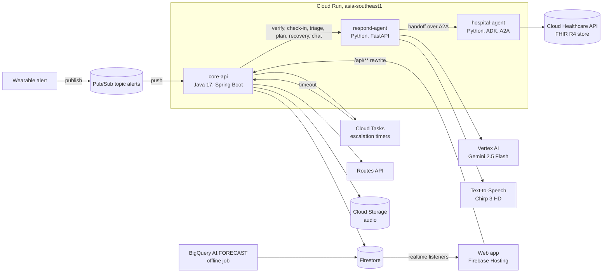

# No One Alone

An AI care agent for older people who live alone. When a wearable raises a critical alert, the agent checks whether it is real, talks to the person in their own language and form of address, decides how urgent it is, and gets the right family member to the door. For a suspected stroke it sends a pre-arrival packet to a stroke-ready hospital before the ambulance gets there. After discharge it turns the hospital's plan into plain reminders.

Entry for the Google Cloud AI Builder Cup, Sustainability & Social Impact track. Live demo: https://noonealone.insidesync.ai

> [!IMPORTANT]
> **The live demo runs one emergency at a time and is shared by everyone who opens it. If the Emergency page says the demo is busy, or a run you started resets, someone else is trying it too. Wait a minute and reload the page.**

All people, places and medical records in this repo are fictional.

## Architecture



| Part | Folder | What it does |
|---|---|---|
| core-api | `core-api/` | Owns the incident. Takes alerts from Pub/Sub, runs the state machine (verify, check-in, triage, escalate, hand off, recover), sets escalation timers in Cloud Tasks, gets travel times from the Routes API and writes every state change to Firestore. Serves the web's `/api` routes. |
| respond-agent | `agents/respond/` | The care agent's judgement. Rules decide verification, triage and the escalation plan. Gemini judges the person's spoken check-in answers (for example slurred speech), writes the recovery summary and answers questions in the chat. Chirp 3 HD speaks every line in the person's language. |
| hospital-agent | `agents/hospital/` | An ADK agent served over A2A. It reads the person's FHIR R4 record, applies their sharing consent and builds the pre-arrival packet for the receiving emergency department. The packet is built by rules, with no LLM, so it only ever contains what the record says. |
| Web app | `web/` | Vite, React and TypeScript. Views for the person, the family, the hospital and the community. It reads Firestore in real time, so the family and hospital screens move as the incident moves. |
| Forecast job | `data/predict/` | An offline job that screens family history and runs BigQuery `AI.FORECAST` (TimesFM) on synthetic blood pressure readings, then writes the result to Firestore for the "What's ahead" view. |
| Infra | `infra/` | PowerShell scripts that set up the Google Cloud project and deploy each part. |

### The emergency flow

1. A critical alert (for example a fall or a heart-rate spike at night) is published to Pub/Sub. A push subscription delivers it to core-api.
2. core-api asks respond-agent to verify the alert against recent readings and opens an incident in Firestore.
3. respond-agent runs a voice check-in. Each line is spoken with Chirp 3 HD and the audio is stored in Cloud Storage. The person's recorded answer goes straight to Gemini, which transcribes it and judges whether the speech is clear, slurred or missing in one call, with no separate speech-to-text step.
4. Triage combines the readings and the check-in into a level: OK, monitor, come now or emergency.
5. core-api escalates through the person's Health Circle. Each step has a Cloud Tasks timer, so an unanswered request moves on to the next person. The Routes API gives each helper's travel time.
6. At emergency level, respond-agent hands off to hospital-agent over A2A, with a plain HTTP call as fallback. hospital-agent reads the FHIR store, keeps only what the person agreed to share, and returns a pre-arrival packet for a stroke-ready hospital.
7. After discharge, the hospital approves a recovery plan. respond-agent turns it into reminders and a short spoken summary, and the incident closes.

## Google Cloud services

Everything runs in `asia-southeast1` (Singapore) except Gemini (Vertex AI `global` endpoint), Firebase Hosting (global CDN) and the Routes API (global).

**Running in the live demo**

| Service | Used for |
|---|---|
| Cloud Run | Runs core-api, respond-agent and hospital-agent. The two agents are private: core-api and respond-agent call them with Google-signed ID tokens. |
| Vertex AI, Gemini 2.5 Flash | Three jobs in respond-agent: listens to the person's recorded answer and returns the transcript and a speech judgement (clear, slurred or missing) in one call, writes the recovery summary, and answers questions in the Ask Noa chat. |
| Cloud Text-to-Speech, Chirp 3 HD | Noa's voice (Aoede, en-AU and vi-VN) for check-ins, the emergency call script and recovery reminders. |
| Agent Development Kit (ADK) | hospital-agent is an ADK agent, served over A2A. respond-agent calls Gemini directly and does not use ADK. |
| A2A protocol | respond-agent sends the hospital handoff to hospital-agent over A2A, with a plain HTTP call as fallback. |
| Cloud Healthcare API (FHIR R4) | A live FHIR store with each person's synthetic medical record and consent. hospital-agent reads it for the pre-arrival packet. |
| Pub/Sub | Alert intake: topic `alerts` with a push subscription to core-api. |
| Cloud Tasks | Escalation timers: queue `escalation` calls core-api back when a step times out. |
| Firestore | Incidents, people, Health Circles, hospitals, forecasts and recovery plans. The web listens to it in real time. |
| Cloud Storage for Firebase | Noa's audio for each incident (`audio/{incidentId}/`). The web plays it back from there. |
| Google Maps Platform, Routes API | Real travel times: each relative's ETA to the person, and the ETA to each hospital when choosing where to send the packet. |
| Firebase Hosting | Serves the web app and rewrites `/api/**` to core-api. |
| Firebase Authentication | Anonymous sign-in for every visitor. Firestore and Storage only allow reads from signed-in users. |
| Secret Manager | Holds the Maps API key. Cloud Run reads it when an instance starts. |
| IAM | One service account per service with only the roles it needs. |
| Cloud Logging and Cloud Monitoring | Logs and metrics for the three Cloud Run services. |

**Used to build and prepare the demo**

| Service | Used for |
|---|---|
| Cloud Build and Artifact Registry | Build the container images and store them in `cloud-run-source-deploy` (`gcloud run deploy --source`). |
| Workload Identity Federation | Lets GitHub Actions deploy to Google Cloud with no stored keys. |
| BigQuery | `AI.FORECAST` (TimesFM) over synthetic blood pressure for the day-21 forecast. Run once as an offline job; the result is stored in Firestore. |
| Vertex AI, Gemini 2.5 Flash | Writes the plain-language explanations for the family screening and the forecast in the same offline job. Any output that is not grounded in the input facts is dropped. |
| Cloud Text-to-Speech, Chirp 3 HD | Fixed clips shipped with the web app (`tools/gen_clips.py`): Noa's set lines (Aoede), and the simulator's autopilot voices for Margaret (Gacrux) and the 000 operator (Charon). |

The web also supports the Google Maps JavaScript API, but the live demo is built without a key and draws its own 3D map from OpenStreetMap data.

## Repository layout

```
agents/hospital   hospital-agent (ADK, A2A, FHIR)
agents/respond    respond-agent (rules, Gemini, Chirp)
core-api          incident state machine (Spring Boot)
data/predict      family screening and BigQuery forecast job
infra             project setup and deploy scripts
web               web app (Vite, React, TypeScript)
```

## Setup

Prerequisites: Google Cloud CLI, Firebase CLI, Java 17, Python 3.12, Node.js (version in `web/.nvmrc`) and Docker.

```
gcloud auth login
gcloud auth application-default login
firebase login
powershell -ExecutionPolicy Bypass -File infra\setup.ps1 -ProjectId <project-id> -BillingAccount <billing-id> -TeamEmails "you@example.com"
```

The script enables the APIs and creates the service accounts, Firestore, the Pub/Sub topic, the Cloud Tasks queue, the FHIR store and the Maps key. Then set the project ID in `.firebaserc` and finish the console steps it prints.

## Run locally

```
cd core-api
mvn spring-boot:run
```

```
cd agents\respond
python -m venv .venv
.venv\Scripts\pip install -r requirements.txt
.venv\Scripts\uvicorn main:app --port 8081
```

```
cd web
npm ci
npm run dev
```

The web app runs on mock data by default. Set `VITE_DATA_SOURCE=firebase` in `web/.env.local` to use Firestore and the real flow.

## Deploy

```
powershell -ExecutionPolicy Bypass -File infra\deploy.ps1 -ProjectId <project-id> -Target all
```

`-Target` is `all`, `core-api`, `respond`, `hospital` or `web`.

## CI/CD

- CI (`.github/workflows/ci.yml`) runs the tests for every part on each pull request and on pushes to `dev`.
- Deploy (`.github/workflows/deploy.yml`) runs after a green CI on `dev` and deploys only the parts that changed, through `infra/deploy.ps1`.
