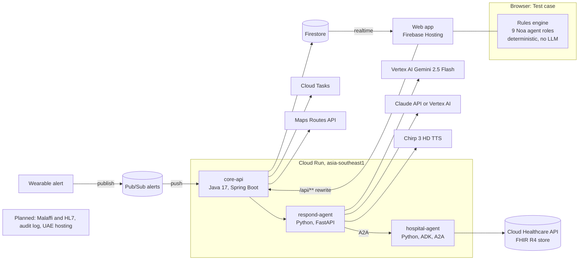

# Architecture

Three layers, kept apart on purpose: what runs in production today, what runs in the Test case, and what is planned.

## 1. Running in production today

Checked against `README.md`, `firebase.json` and `infra/`.

| Part | Where | What it does |
|---|---|---|
| Web app | `web/`, Firebase Hosting | Vite, React, TypeScript. Reads Firestore in real time. `/api/**` is rewritten to core-api (`firebase.json`). |
| core-api | `core-api/`, Cloud Run | Java 17, Spring Boot. Owns the incident state machine. Takes alerts from Pub/Sub, sets escalation timers in Cloud Tasks, gets travel times from the Routes API, writes every state change to Firestore. |
| respond-agent | `agents/respond/`, Cloud Run | Rules decide verification, triage and the escalation plan. Gemini 2.5 Flash judges recorded spoken answers, writes the recovery summary and answers chat. Chirp 3 HD speaks the lines. |
| Family-health AI | respond-agent `/noa/say` and `/noa/understand`, core-api `/api/noa/*` | The browser sends a call id, the language and structured facts. respond-agent holds the prompts and checks the reply (numbers only from the facts, right script, no dose, no diagnosis, no advice against emergency care, word limit). Fast model Claude Haiku 5.5 for short turns and reading replies, Claude Opus 5.5 for explanations, the pathway and the referral note. One audit line per call: call id, hash of the facts, prompt version, model, check result. |
| hospital-agent | `agents/hospital/`, Cloud Run | An ADK agent served over A2A. Reads the person's FHIR R4 record, applies consent (fail closed: only an active permit shares anything) and builds the pre-arrival packet by rules, with no LLM. |
| Data stores | Firestore, Cloud Healthcare API (FHIR R4), Cloud Storage | All content is synthetic. Firestore rules: signed-in users read, only service accounts write. |
| Messaging | Pub/Sub topic `alerts`, Cloud Tasks queue `escalation` | Alert intake and escalation timeouts. |
| Security basics | IAM, Secret Manager, Firebase Auth | One service account per service. Agents are private and called with Google-signed ID tokens. Visitors sign in anonymously. |
| Claude route | respond-agent | Claude Haiku 5.5 and Opus 5.5. When `ANTHROPIC_API_KEY` is set, respond-agent calls the Claude API (api.anthropic.com), which is outside Google Cloud and outside `asia-southeast1`. Without it, Claude runs on Vertex AI. Used only when the live AI switch (`VITE_NOA_AI`, off by default) is on. |
| Delivery | GitHub Actions, Cloud Build, Workload Identity Federation | CI on pull requests and on `dev`. Deploy after green CI. |

Family journey, live AI switch (off by default): with `VITE_NOA_AI=on` the family-health panel sends each agent message to core-api, and respond-agent has Claude write the wording from the facts the engine chose. A message that fails a check, times out after 8 seconds or errors shows the prepared text. Typed replies on risky questions are also read by keywords, and the more urgent reading wins. The page-open auto-run stays on prepared text.

Region: everything runs in `asia-southeast1` (Singapore). Exceptions: Gemini uses the Vertex AI `global` endpoint. Claude uses the Claude API (api.anthropic.com, outside Google Cloud) when `ANTHROPIC_API_KEY` is set, or the Vertex AI `global` endpoint otherwise. Firebase Hosting and the Routes API are global. The demo is not hosted in the UAE (see section 3).

## 2. In the Test case (browser only)

The Test case is an overlay in the live web app (`web/src/features/testcase/`). It does not call the backend and never touches a real record.

- **Engine** (`engine/`): pure TypeScript with no React. The same engine drives the screens, the "Run it for me" autopilot and the benchmark.
- **Rules** are published and numbered: R1 to R12 (safety), P1 to P9 (prevention), F1 and F2 (family heart score).
- **The 9 Noa agents** (Guardian, Voice, Responder, Courier, Insight, Forecast, Coach, Navigator, Analyst) are roles in the engine. Each has a written "may do" and "may not do". They are not separate services. The hand-offs between them are shown on screen.
- **No LLM makes a decision.** Scores and routing come from rules. The explanations are prepared text in two languages, labelled "Prepared text". "AI-written" appears only if a live explanation is loaded, and the rules still decide. No live explanation is wired in this build.
- **Voice:** the speech check uses the browser Web Speech API where it exists (Chrome, Edge). Typing or choosing a sample also works.
- **Demo database:** ten tables (agents, patients, consents, observations, checkins, alerts, tasks, encounters, reports, audit), kept in memory for the run.
- **Benchmark** (`bench/`): 252 labelled scenarios, run by the same engine. See [test-report.md](test-report.md).
- **Loading:** the Test case text and CSS load only when it is opened, so the main bundle stays smaller.

Why not use the backend for the Test case? The deployed chat service only knows Moza's case, so it cannot explain the other fictional people safely. Fixed text also gives repeatable results for judges.

## 3. Planned, not built

- Link to **Malaffi** (the Abu Dhabi shared health record) and **HL7** messages. In the Test case the Malaffi consent row is shown as "planned".
- A **production audit log** (who saw what, when). Today core-api writes state changes to the incident timeline, and the Test case shows a demo audit table.
- **UAE hosting** under Department of Health rules.
- The IFHAS data feed, to know who is due.
- Clinical sign-off of every rule and script.
- A bridge from wearable data on another cloud to this one. It is not in this repository.

## Scale and deployment readiness (honest view)

- Cloud Run, Firestore, Pub/Sub and Cloud Tasks scale without server management. We have not load-tested them.
- The live emergency demo (the Emergency page, not the Test case) runs one emergency at a time and is shared by everyone. That is a demo limit.
- Deploy is scripted (`infra/setup.ps1`, `infra/deploy.ps1`) and runs from GitHub Actions. Moving to the UAE means running the scripts again in a UAE region with a new project.
